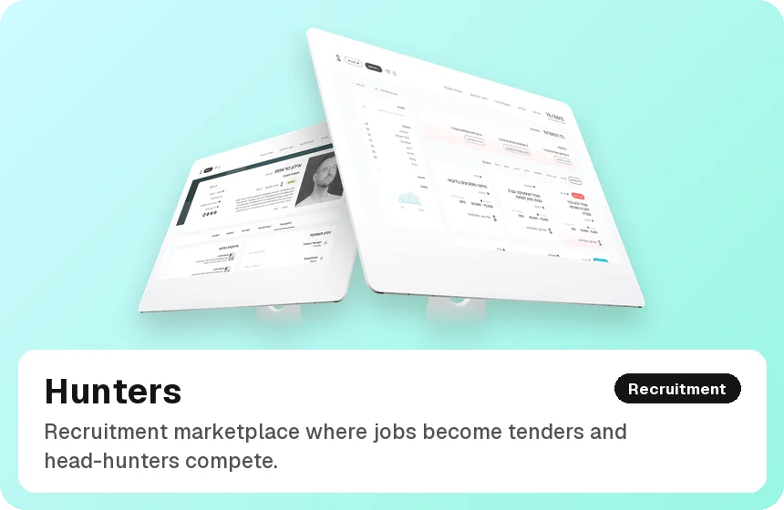
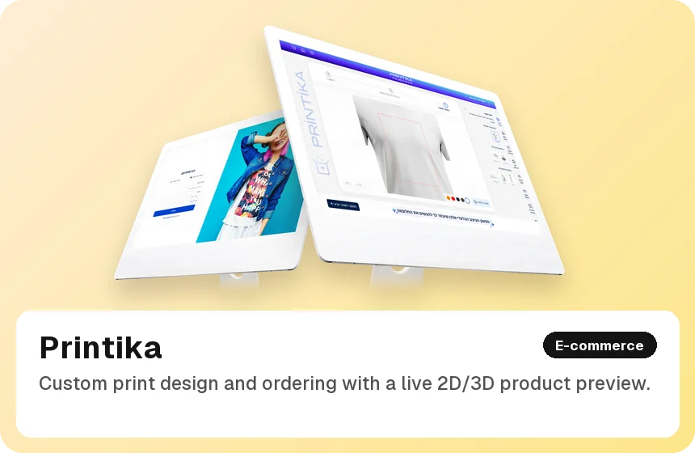
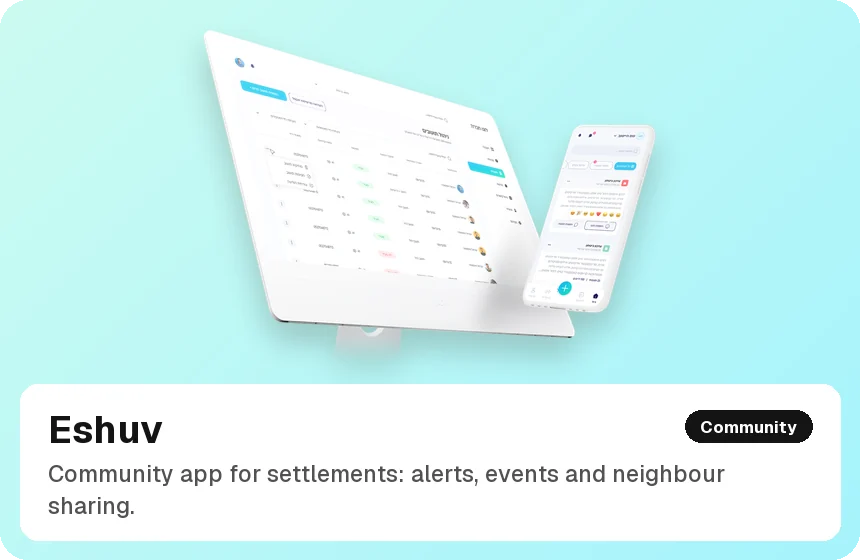
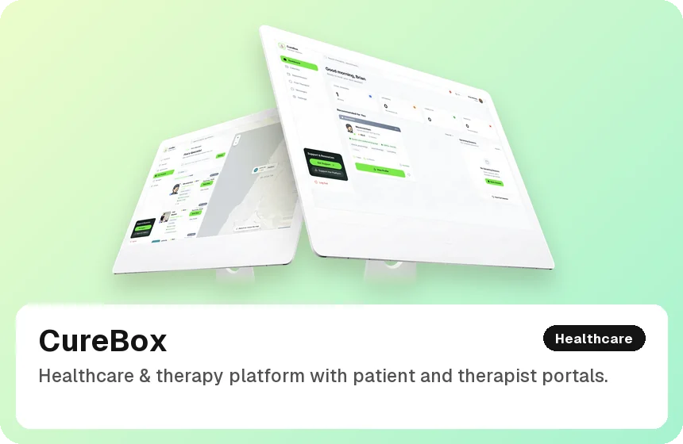

<div align="center">

<a href="https://murbxp.is-a.dev">
<picture>
  <source media="(prefers-color-scheme: dark)" srcset="./assets/header-dark.svg">
  <source media="(prefers-color-scheme: light)" srcset="./assets/header-light.svg">
  
</picture>
</a>

</div>

I take products from first prototype to production: web apps, mobile apps, AI features and the
integrations that hold them together, for healthcare, fintech, proptech and community teams. Most of
that work lives in private client repositories, so the numbers below count every repo I commit to,
not just the public ones.

<div align="center">

<picture>
  <source media="(prefers-color-scheme: dark)" srcset="./assets/proof-dark.svg">
  <source media="(prefers-color-scheme: light)" srcset="./assets/proof-light.svg">
  
</picture>

</div>

## Selected work

<p align="center">
  <a href="https://murbxp.is-a.dev/projects/clutch-ai"></a>
  <a href="https://murbxp.is-a.dev/projects/hunters"></a>
  <a href="https://murbxp.is-a.dev/projects/printika"></a>
  <a href="https://murbxp.is-a.dev/projects/eshuv"></a>
  <a href="https://murbxp.is-a.dev/projects/curebox"></a>
  <a href="https://murbxp.is-a.dev/projects/craftad"></a>
</p>

<p align="center"><sub>Each tile opens the full case study on <a href="https://murbxp.is-a.dev">murbxp.is-a.dev</a>.</sub></p>

## Open source

<a href="https://github.com/MurbX/screenrecorder">
<picture>
  <source media="(prefers-color-scheme: dark)" srcset="./assets/tool-1-dark.svg">
  <source media="(prefers-color-scheme: light)" srcset="./assets/tool-1-light.svg">
  
</picture>
</a>

<div align="center">

<a href="https://murbxp.is-a.dev">
<picture>
  <source media="(prefers-color-scheme: dark)" srcset="./assets/cta-dark.svg">
  <source media="(prefers-color-scheme: light)" srcset="./assets/cta-light.svg">
  
</picture>
</a>

<sub>
<a href="https://murbxp.is-a.dev/resume.pdf">Resume</a> &nbsp;·&nbsp;
<a href="https://www.linkedin.com/in/brian-mutuku-developer/">LinkedIn</a> &nbsp;·&nbsp;
<a href="https://x.com/MurbBrian_ke">X</a> &nbsp;·&nbsp;
<a href="mailto:brianmurb22@gmail.com">Email</a> &nbsp;·&nbsp;
<a href="https://cal.com/brian-mutuku-dev/30min">Book a 30-minute call</a>
</sub>

</div>

<br>

<details>
<summary><b>How this page builds itself</b></summary>

<br>

The cards are SVGs generated by [`scripts/render.mjs`](scripts/render.mjs) and refreshed every six
hours by [a scheduled workflow](.github/workflows/refresh.yml). No third-party widget services, so
nothing here breaks when someone else's server goes down. Fonts (Geist and Instrument Serif) are
embedded as small subsets, so the cards look the same everywhere.

**Why it doesn't use the contribution graph.** GitHub's `contributionsCollection` API leaves out
commits to private and organization repos, and most of my work lives in client and team repos. So the
renderer walks the commit history of every repository the token can reach and counts commits
directly, then merges in the contribution calendar (taking the larger value per day, never the sum).
Only totals are published; repository and client names never appear on this page.

```
scripts/
  render.mjs          fetch → render → write assets/
  lib/github.mjs      REST commit harvest + GraphQL merge
  lib/theme.mjs       dark & light palettes
  lib/fonts.mjs       embedded font subsets + exact text measuring
  lib/svg.mjs         primitives
  cards/*.mjs         header, proof, tool, cta
  fonts/              WOFF subsets and glyph metrics
assets/work/          project tiles (static)
profile.config.json   name, headline, highlights, stack, tools — edit this, not the code
```

Run it locally:

```bash
PROFILE_TOKEN=$(gh auth token) node scripts/render.mjs
```

Private work only counts when the token can see it: create a PAT with `repo` scope and save it as the
repository secret `PROFILE_TOKEN`. Without it the workflow falls back to the Actions token and counts
public repos only.

</details>
